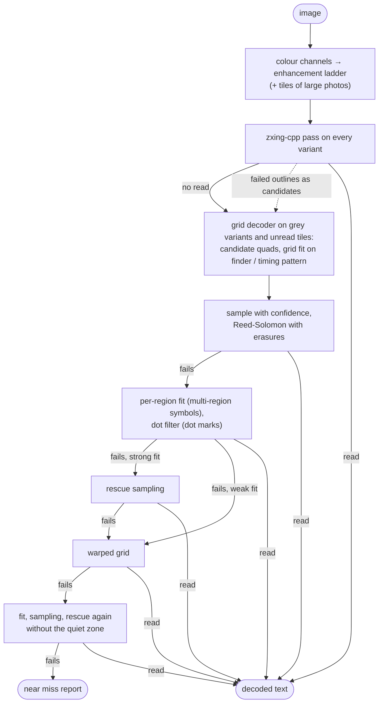

# Features

What dpmread does today, how it does it, how fast it is and how well it
reads. Planned work is in [roadmap.md](roadmap.md). Figures are for
version 0.2 and are updated with each release.

## Contents

- [How a read works](#how-a-read-works)
- [Supported symbols and data](#supported-symbols-and-data)
- [Output](#output)
- [Desktop GUI](#desktop-gui)
- [Library for apps](#library-for-apps)
- [Performance](#performance)
- [Benchmarks](#benchmarks)
- [Known limits](#known-limits)
- [Python reference readers](#python-reference-readers)

## How a read works



1. **Colour channels.** The image is converted to several grey channels
   (luminance, inverted saturation, blue, L\*), because a burn on wood often
   stands out more in saturation or colour than in brightness.
2. **Enhancement ladder.** Each channel goes through a fixed chain of
   variants at a normalised size: contrast-limited histogram equalisation
   (CLAHE), background flattening (division by a heavily blurred copy, which
   removes lighting gradients), smoothing sized to the module, Otsu and
   adaptive thresholds, a median filter with sharpening, a "merge dots"
   closing that joins separate laser or peen dots into solid modules, grain
   suppression, and a gamma bracket. Large photos are also searched in
   overlapping tiles. Polarity is handled with an inverted chain.
3. **Library pass.** Each variant goes to [zxing-cpp](https://github.com/zxing-cpp/zxing-cpp),
   which reads clean and moderately damaged symbols in milliseconds. Most
   images end here.
4. **Grid decoder** (when the library pass fails, within the time budget):
   - finds candidate quadrilaterals (thresholds, morphology, contours,
     minimum-area rectangles, edge snapping);
   - for every plausible symbol size, fits the module grid to the
     **finder and timing pattern** (the solid L and the alternating edges),
     refining the corners for the best contrast between the pattern's dark
     and light modules, and tracking the timing modules along each edge;
   - samples each module and records how certain the dark / light decision
     is;
   - runs Reed-Solomon decoding with the least certain codewords marked as
     **erasures**. An erasure costs half as much correction capacity as an
     unknown error, so this repairs up to twice as much damage when the
     uncertain modules are the damaged ones;
   - if that fails on a symbol with several data regions (from 32×32,
     rectangles from 8×32, DMRE), every region is **re-fitted on its own
     alignment lines** (the solid and dashed lines around it) and sampled
     with its own perspective, which follows a bend or pitch drift inside
     the symbol;
   - if that fails and the solid finder line shows **separate dots** (the
     darkness dips between modules), every module is sampled with a
     **disc filter** of the measured dot size instead of a point
     footprint, for dot-peen and laser-dot marks with gaps between dots;
   - if that fails, **rescue sampling**: a local threshold plane fitted to
     the fixed-pattern modules, 5×5 neighbourhood thresholds, and voting
     over several re-samplings and gamma values;
   - if that fails, a **warped grid**: the timing pattern is tracked
     globally along each edge, so marks whose module pitch drifts across
     the symbol (uneven marking speed, curved or stretched material) are
     sampled at the real module positions instead of an evenly spaced grid;
     a square warped grid is also decoded transposed across its
     anti-diagonal, the one other frame with the same finder and timing
     pattern, because the warp fit of that orientation can land elsewhere;
   - if that fails, the same steps again without assuming a quiet zone
     around the symbol (marks printed right up to an edge or a label).
5. **Result.** The first decode that passes Reed-Solomon wins
   (`--exhaustive` tries every method and keeps the majority result). If
   nothing decodes, the report gives a **near miss**: the best candidate's
   size, how many errors were found against the correction capacity, and a
   module-count estimate, which tells whether the mark is close to readable
   or physically destroyed.

With `--multi`, each decoded symbol is covered and the image is read again
until no further symbol is found.

`--expect RxC` and `--polarity` restrict the search to known symbol sizes
and polarity. On a fixed setup this cuts the time per image considerably.

All decisions are deterministic: the same image gives the same result for
any number of worker threads and on any x86-64 CPU (vectorised code paths
are chosen at run time and give the same reads as the plain ones).

## Supported symbols and data

| | |
|---|---|
| Symbology | Data Matrix ECC 200 (ISO/IEC 16022) |
| Sizes | all 24 square sizes (10×10 … 144×144), 6 rectangular sizes, DMRE rectangular extension (ISO/IEC 21471) |
| Polarity | dark on light, light on dark (`--polarity any` default) |
| Orientation | any rotation, mirrored symbols |
| Encodation | ASCII, C40, Text, X12, EDIFACT, Base 256; GS1 (FNC1), ECI with per-segment character sets (ISO-8859-x, UTF-8, Shift_JIS, GB18030, …), macro 05 / 06, structured append (reported) |
| Image files | PNG, JPEG, BMP, TIFF, WebP, GIF; 8 and 16 bit, transparency composited on white, EXIF orientation applied |
| File names | any Unicode path, also on Windows |

## Output

**Text report** (default), per image:

- decoded text (with non-printable bytes escaped) and hex dump;
- engine and enhancement variant that read it, and the other variants
  that agree;
- symbol: size, shape, data regions, data / error-correction codewords,
  Reed-Solomon blocks, mirroring;
- error correction: codewords corrected and erasures declared per block,
  corrected positions;
- encodation segments with mode and codeword range, GS1 / ECI / macro /
  structured-append flags;
- **quality estimate** in the style of ISO/IEC 15415 and AIM DPM
  (ISO/IEC TR 29158): symbol contrast, modulation, axial non-uniformity,
  unused error correction, fixed-pattern damage, module size in pixels,
  rotation, skew, pitch drift, overall grade. Indicative only: the reader
  does not control lighting or optics, so it is not a verifier;
- corner points of the symbol in the image;
- with `--matrix`, the sampled module matrix as text art.

**JSON** (`--json`): an array with one object per image carrying the same
fields, for scripts and databases.

**Debug images** (`--debug DIR`): every enhancement variant and an
annotated copy of the image with the symbol outline and grid.

**Grid fits** (`--dump-fits DIR`): per image `NAME.fits.json` with the
grid fit that read (if any) and the best three failed fits, one per grid
job: symbol size, variant, mirrored flag, finder / timing score,
fixed-pattern module errors, every module centre in image pixels and the
reader's own module bits and confidences for the fit; and
per fit `NAME.fitN.npy`, the variant resampled through the fit at 6 pixels
per module with a 2-module margin (float32, gray 0..1, symbol dark on
light). Material for training and checking a module classifier; the read
itself is unchanged. Images with the same name in different folders
overwrite each other's files.

**Symbol detector** (cargo feature `ml`, on in the release zips, off in a
plain `cargo build`): when one zxing call on the gray image does not read,
a finder network on the whole frame and a measurer on a full-resolution
crop give the main symbol's corners, polarity and three size candidates;
the grid decoder tries them on a crop first, and zxing and the variant
ladder run only when that gives no read. The report names the variant
`detector > …`. Weights are embedded in `dm-ml` (tract). `--no-detector`
or the GUI setting turns it off.

**Module classifier** (cargo feature `ml`, as the detector): when every
grid attempt has failed, the three best failed fits are classified again
by a small convolutional network (33 k weights, crate `dm-ml`, run with
tract) instead of the threshold, on the `--dump-fits` input, and decoded
with the same soft-erasure Reed-Solomon. Fits with more than 25 % wrong
finder / timing modules are skipped. Reads that succeed without it are
unchanged; the report names the sampling "module classifier". One call
takes about 2 ms at 10×10, 9 ms at 24×24 and 47 ms at 64×64 (one
thread, Ryzen 7 5700X). Training code: `ml/`.

## Desktop GUI

`dpmread-gui`:

- drop files or folders on the window, or use *Add files* / *Add folder*;
  paths on the command line are queued at start;
- images are read one after another in the background; the table shows
  status, file name, engine, decoded text and time, sortable, with a
  *failed only* filter;
- detail pane: annotated image with zoom and pan, decoded text with *Copy*,
  the full technical report in its own window;
- toolbar: polarity, time budget, *all codes* (`--multi`); a settings
  window for expected sizes, engines, exhaustive mode, worker threads and,
  in builds with `ml`, the symbol detector and module classifier (kept
  between sessions);
- *Stop* ends the image being read and keeps the queue, *Continue* goes on;
  *Read again*, *Open folder* and *Copy path* per row;
- export of the finished results as CSV (one line per symbol) or JSON;
  CSV cells that start with `=`, `+`, `-`, `@`, tab or carriage return get
  a leading `'`, so a decoded text cannot become a spreadsheet formula.

The GUI uses OpenGL 2; on Windows without an OpenGL 2 driver (virtual
machines, remote desktop) it switches to Direct3D 12.

## Library for apps

`dm-ffi` (`rust/crates/dm-ffi`) makes the reader callable from Kotlin
through [uniffi](https://github.com/mozilla/uniffi-rs), for Android apps:

- `Reader(jobs)` with `read(path, options)`: the same JSON object per image
  as `--json`, the technical report, and per symbol the decoded text, its
  outline in image pixels and the sampled module matrix;
- `stop()` ends a running read from another thread;
- options as the command-line flags that affect a read (engines, budget,
  expected sizes, polarity, exhaustive, all codes).

`rust/tools/build_android.sh` builds `libdm_ffi.so` for `arm64-v8a` and
`x86_64` (Android 8, API 26, and later) and the Kotlin bindings. Not part
of the release zips.

## Performance

Measured on an AMD Ryzen 7 5700X (8 cores, 16 threads), Linux, default
options, 60 s budget, over the 193 images of the [public test
sets](#benchmarks):

| | dpmread (Rust, `main` 2026-10-13) | Python reference (v2) |
|---|---|---|
| Total time (sum over images) | 107 s | 772 s |
| Median per image | 0.28 s | 0.93 s |
| 90th percentile per image | 0.40 s | 2.68 s |
| Slowest image | 12 s | 57 s |

Most images are read by the library pass in well under a second. The time
goes into images that need the grid decoder; those take seconds to tens of
seconds and stop at the budget if nothing decodes. After a library read,
the grid fit that fills in the symbol, error-correction and quality fields
gets at most 2 s; `--no-analysis` skips it (same text, those fields
absent). On the project's own set
of hard wood marks, the Rust reader is about 5.6 times faster than the
Python reference with identical results.

Build and run-time footprint:

| | Linux x86-64 | Windows x64 |
|---|---|---|
| CLI binary (feature `ml`) | 27.0 MB | not measured with `ml` yet (7.0 MB without) |
| GUI binary (feature `ml`) | 34.6 MB | not measured with `ml` yet (17.1 MB without) |
| Needs | glibc ≥ 2.28 (2018 distributions on); the GUI ships libxkbcommon(-x11) and libxcb-xkb (0.6 MB) | Windows 10 / 11, no Visual C++ Redistributable |
| CPU | any x86-64; AVX2 / FMA used when present | same |

Each [release](https://github.com/aharjajarvi/dpmread/releases) has one zip
per platform, built by GitHub Actions from the version tag, with `LICENSE`,
`NOTICE` and `THIRD_PARTY_LICENSES.md` (generated from the dependency tree,
so every bundled crate and C/C++ library is listed), and a `SHA256SUMS`
file for both zips.

## Benchmarks

Three public sets, fetched and pinned by hash with
`tools/fetch_public_sets.py` (not stored in the repository):

| Set | Images | Content | Licence |
|---|---|---|---|
| Karrach 2021 | 58 | industrial photos of Data Matrix codes, many with several codes per image; from L. Karrach, E. Pivarčiová, *Comparative Study of Data Matrix Codes Localization and Recognition Methods*, J. Imaging 2021 | CC BY 4.0 |
| zxing-cpp samples | 97 | the zxing-cpp project's Data Matrix test images | Apache-2.0 |
| ZXing (Java) samples | 38 | the ZXing project's Data Matrix test images (duplicates of the zxing-cpp set removed) | Apache-2.0 |

`tools/score_public.py` scores a run: an image is a **hit** if the decoded
text matches one of the expected texts; a **false read** is decoded text
that matches none of them. Code level counts every expected symbol, which
matters for the Karrach images with several codes.

Results, one symbol per image (default) and every symbol (`--multi`), 60 s
budget:

| Reader | Hits (images) | False reads | Code level, default | Code level, `--multi` |
|---|---|---|---|---|
| dpmread 0.2 | **188 / 191** (98.4 %) | 0 | 245 codes: 76.7 % | **97.6 %** |
| dpmread 0.2, zxing-cpp pass only (`--engines zxing`) | 177 / 191 (92.7 %) | 0 | 72.2 % | – |
| Python reference v1 / v2 | 181 / 191 (94.8 %) | 1 | 73.9 % | – |

Two of the 193 images have no ground truth and are not scored. The
zxing-cpp-only row uses the same enhancement ladder, so it is already well
above zxing-cpp on the raw images; the difference to the first row is what
the grid decoder adds.

For orientation: published code-level figures on the
Karrach set are about 65 % for zxing-cpp and 72 % for libdmtx (multi-symbol
reading, from a third-party benchmark); dpmread reaches 97.3 % on that set
with `--multi`.

Reproduce:

```sh
python tools/fetch_public_sets.py
cd rust && cargo build --release && cd ..
python tools/score_public.py --reader rust
python tools/score_public.py --reader rust --multi
```

`baseline/public_rust.json` and `baseline/public_rust_multi.json` hold the
stored results; every change is checked against them (no hit lost, no false
read added).

## Known limits

- **Physical damage beyond error correction.** If more modules are wrong
  than Reed-Solomon can correct, even with erasures, no reader can recover
  the content. The near-miss report shows how far a mark is from that
  limit.
- **Destroyed finder or timing pattern.** The grid is always anchored on
  the fixed pattern. Heavy over-burn that merges the timing modules along
  an edge, or a missing L edge, makes the fit fail.
- **Symbol size choice on blurred marks.** With very low resolution
  (below about 3 pixels per module) neighbouring sizes fit almost equally
  well and the reader may not find the right one; `--expect` helps.
- **Large multi-region symbols on curved surfaces.** The grid inside a
  symbol with several data regions is extrapolated from the outer edges
  only.
- **Speed on failing images.** An image that does not decode uses the whole
  budget. Lower `--budget` or set `--expect` / `--polarity` for line use.
- Data Matrix only; the old ECC 000–140 variant is not supported.

## Python reference readers

`python/datamatrix_reader.py` (v1) and `python/datamatrix_reader_v2.py` (v2, adds the
warped grid) are the Python readers the Rust reader was ported from, using
numpy, OpenCV and zxing-cpp, with libdmtx as an optional third engine. The
Rust reader gives the same reads as v2 on the project's test images and is
checked against it on every change. Both Python readers are kept as
references and receive bug fixes only.
